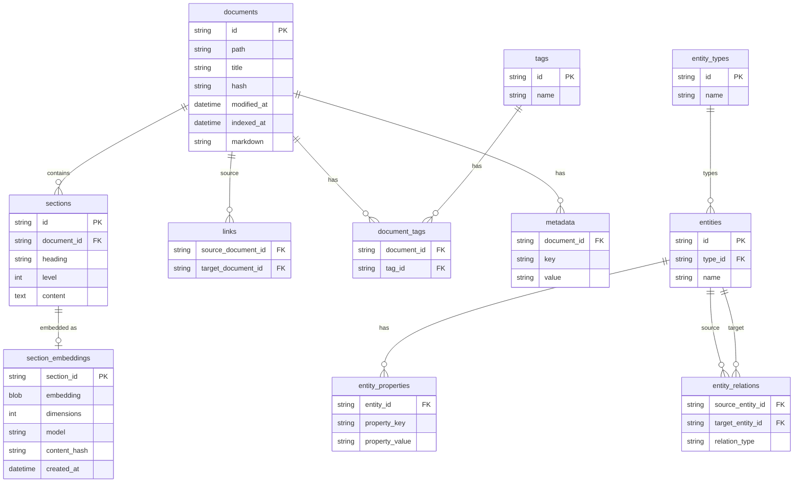
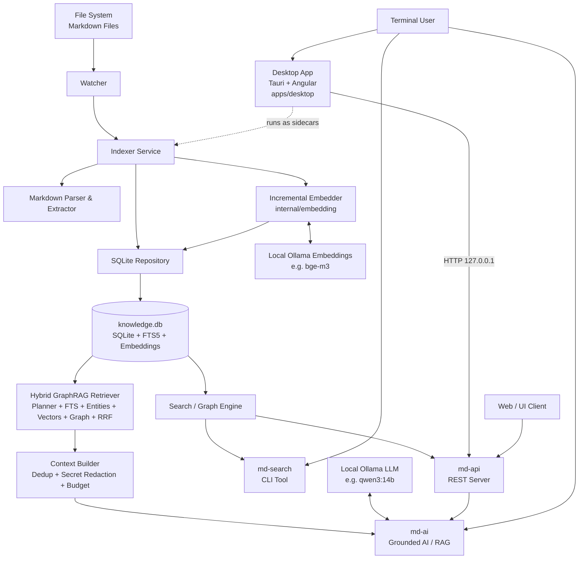

# Markdown Knowledge Indexer & Search Engine

This project provides a local, lightweight knowledge-graph and search infrastructure for Markdown-based note systems (such as Obsidian). The system consists of the following components:

1. **md-indexer**: Monitors Markdown files and incrementally builds a SQLite-based index and knowledge graph (optionally with local section embeddings). Markdown files remain the single source of truth.
2. **md-search**: A CLI knowledge explorer that operates on the SQLite database (without filesystem access) to perform full-text search, backlink, and graph traversal queries.
3. **md-api**: A REST API that exposes the search and graph features over HTTP, plus the grounded AI endpoints when started with `-ai`.
4. **md-ai**: A grounded AI assistant (Hybrid GraphRAG) on top of the index, answering with a local Ollama model or, on explicit choice, a cloud model (Ollama Cloud, OpenRouter, NVIDIA NIM, Claude, Gemini).
5. **Desktop App** (`apps/desktop`): A Tauri + Angular + Spartan-ng client to select a vault and models and ask questions, running `md-indexer` and `md-api` as local sidecars.

## Architectural Principles

The system is based on the principles of **Clean Architecture**:
- **Source of Truth**: Markdown files in the filesystem are the only truth. The SQLite database is a pure materialized index and can be deleted and rebuilt at any time.
- **Separation of Concerns**: Strict separation between file parsing (`md-indexer`) and query operations (`md-search` & `md-api`). The search layer has no filesystem access and reads exclusively from the database.
- **Clients via API only**: Client apps under `apps/` talk to the system exclusively through `md-api`; they never open the database or the vault files directly.
- **Concurrent Access**: File databases run in SQLite WAL mode with a busy timeout, so `md-indexer` (writer) and `md-api` / `md-search` (readers) can share one database.
- **Graph Engine via Recursive CTEs**: Graph traversals (dependency trees, impact analysis, shortest paths) are executed in SQLite using recursive Common Table Expressions (`WITH RECURSIVE`), avoiding N+1 query loops while remaining CGO-free.

## Data Model & ER Diagram (SQLite & FTS5)



`documents.id` is the SHA-256 of the note's path relative to the vault root, so every file is its own document even when several notes have identical content; `documents.hash` is the SHA-256 of the content and detects changes. Section IDs are `<document id>-<heading>`; a repeated heading gets `#2`, `#3`, … Renaming or moving a note removes the old document and indexes the new one.

## Component Diagram



*(See [`docs/Hybrid_GraphRAG_DE.md`](docs/Hybrid_GraphRAG_DE.md) and [`md-ai.example.yaml`](md-ai.example.yaml) for detailed Hybrid GraphRAG architecture, configuration, and query-class walkthroughs).*

## Setup & Build

The project uses a Makefile for the build process.

```bash
# Build all components (in ./bin)
make build    # md-indexer
make search   # md-search
make api      # md-api
make ai       # md-ai (grounded AI assistant)

# Desktop app (see "Desktop App" below)
make desktop-dev   # build md-indexer + md-api as sidecars and start the app in dev mode
make desktop       # build installable bundles

# Run all tests
make test
```

### Docker (Multi-Stage Build)

Alternatively, the system can be deployed entirely via Docker:

```bash
docker build -t md-knowledge-system .
docker run -p 8080:8080 -p 8081:8081 -v /pfad/zum/vault:/app/vault md-knowledge-system
```

Inside the container `md-api` runs with `-host 0.0.0.0`, so the published ports work; publish them only to `127.0.0.1` (`-p 127.0.0.1:8081:8081`) unless the API should be reachable from the network.

## Usage & Examples

### Database Location

Each vault gets its own index database, used by all tools and the desktop app:

1. `<vault>/.md_indexer/md_indexer.db` (default). `md-indexer` creates the folder together with a `.gitignore` (`*`), so the database is never committed. Exclude `.md_indexer/` in sync tools (Syncthing, Nextcloud, …) as well: a SQLite file synced between machines can get corrupted.
2. If the vault is not writable: `<user data dir>/md-indexer/vaults/<hash>.db` (`$XDG_DATA_HOME` or `~/.local/share` on Linux, `~/Library/Application Support` on macOS, `%LocalAppData%` on Windows).

`md-indexer` resolves it from `-dir`; `md-api -vault`, `md-search --vault` and `md-ai --vault` (default: current directory) find the existing database and fail with a clear message if the vault has not been indexed yet. An explicit `-db` / `--db` (or `MD_AI_DB_PATH` / `db_path` for `md-ai`) always wins, e.g. to keep using an existing `index.db`.

Nothing inside the vault except `.md_indexer/` is ever written.

### 1. md-indexer (File Watcher & Indexer)

Indexes a folder recursively and monitors it for future changes.

```bash
./bin/md-indexer -dir /path/to/obsidian/vault -port 8080

# Compute local section embeddings for vector retrieval (Ollama, e.g. bge-m3):
./bin/md-indexer -dir /path/to/obsidian/vault -embed-model bge-m3

# Force re-parsing all notes and purging excluded (_templates_, .obsidian) or deleted paths
# without dropping existing section_embeddings:
./bin/md-indexer -dir /path/to/obsidian/vault -force

# Use an explicit database file instead of the vault-local one:
./bin/md-indexer -dir /path/to/obsidian/vault -db index.db
```

### 2. md-search (CLI Explorer)

Allows searching the graph from the terminal. It uses the index of `--vault` (default: current directory) unless `--db` is set.

```bash
# Full-text search via FTS5 (title, content, tags)
./bin/md-search --vault /path/to/obsidian/vault search "encryption strategy"

# Format output as JSON (available on all subcommands)
./bin/md-search search "encryption strategy" --json

# Show details for a specific document
./bin/md-search document "ADR-003"

# Impact analysis for an entity (incoming dependencies via recursive CTE)
./bin/md-search impact "Package Model"

# Dependency tree for an entity (outgoing dependencies via recursive CTE)
./bin/md-search graph "Transformation Engine"
```

**Planned CLI subcommands (Roadmap):**
```bash
./bin/md-search entity "Transformation Engine"
./bin/md-search backlinks "Encryption Service"
./bin/md-search relations "Transformation Engine"
```

### 3. md-api (REST API)

Starts an HTTP server that accepts search and graph requests (default port 8081).

```bash
make api-run
# or manually:
./bin/md-api -vault /path/to/obsidian/vault -port 8081
```

**Endpoints:**

- `GET /health`: System status
- `GET /api/search?q=...`: FTS5 full-text search
- `GET /api/documents/{name}`: Load a specific document
- `GET /api/document?path=...` or `?title=...&from=...`: Original Markdown of an indexed document plus its resolved wikilinks (served from the index, never from disk)
- `GET /api/entities/{name}`: Load an extracted entity (type + properties)
- `GET /api/backlinks/{name}`: Find documents that link to `{name}`
- `GET /api/impact/{name}`: Recursive impact analysis for an entity
- `GET /api/graph/{name}`: Recursive dependency tree for an entity
- `POST /api/ai/ask`: Grounded AI answer (requires `-ai`); optional `model: {provider, name}` selects the answering model, provider failures return `502` with `error_kind`
- `GET /api/ai/models`: Local Ollama models (classified as generation/embedding and local/cloud, with parameter size) plus the configured cloud models, and the default generation/embedding model (requires `-ai`)

`md-api` listens on `127.0.0.1` by default and sends no CORS headers, so neither other machines nor web pages in your browser can read the vault through it. Use `-host 0.0.0.0` (or a specific interface address) only if you need network access: there is no authentication, and the server logs a warning. `md-indexer` accepts the same flag; its own HTTP server only answers `/health` (readiness after the initial index), queries go through `md-api`.

*(The exact specification is documented in the included `openapi.yaml` file).*

### 4. Desktop App (`apps/desktop`)

A Tauri v2 + Angular + Spartan-ng desktop client: pick a vault folder, choose the generation and embedding model, and ask questions. It runs `md-indexer` and `md-api` as local sidecars (bound to `127.0.0.1`) and uses the vault's own database (`<vault>/.md_indexer/`, see "Database Location"); databases from earlier app versions are moved there once. Changing the vault, the embedding model or the `.env` file restarts the sidecars; the answer model is sent with each question (local Ollama models grouped by size, cloud models per provider, see "Cloud LLM Providers"). Cited sources open in an inline Markdown viewer; wikilinks navigate within the vault, and "Zurück"/"Schließen" return to the unchanged answer.

```bash
make desktop-dev   # build sidecars and start the app in dev mode
make desktop       # build installable bundles
```

Prerequisites: Go, Node.js, Rust and the [Tauri system dependencies](https://v2.tauri.app/start/prerequisites/) (on Debian/Ubuntu: `libwebkit2gtk-4.1-dev`, `build-essential`, `libssl-dev`, `libayatana-appindicator3-dev`, `librsvg2-dev`, `libxdo-dev`, `pkg-config`), plus a running Ollama instance. See `apps/desktop/README.md`.

## Example Use Case & Walkthrough

The repository includes a concrete, physically existing sample vault in [`examples/vault/`](examples/vault/) featuring Frontmatter entities, relationships, inline Wikilinks, hashtags, and code blocks:

* [`examples/vault/AuthService.md`](examples/vault/AuthService.md): Service entity declaring relations (`uses: [UserDatabase, TokenSigner]`) and inline Wikilinks.
* [`examples/vault/UserDatabase.md`](examples/vault/UserDatabase.md): Relational database entity referenced by `AuthService`.
* [`examples/vault/TokenSigner.md`](examples/vault/TokenSigner.md): Cryptographic security module implementing `Ed25519` tokens.

### 1. Build All Binaries
```bash
make build search api
```

### 2. Index the Sample Vault
```bash
./bin/md-indexer -dir ./examples/vault -db knowledge.db
```

### 3. Query via CLI Explorer (`md-search`)

**Full-Text Search (FTS5 BM25):**
```bash
./bin/md-search search "Ed25519" -db knowledge.db
```
*Output: Matches `TokenSigner` based on BM25 full-text ranking.*

**Impact Analysis (Reverse Dependency Traversal via Recursive CTE):**
```bash
./bin/md-search impact "UserDatabase" -db knowledge.db
```
*Output: Demonstrates that changing `UserDatabase` directly impacts `AuthService`.*

**Dependency Tree (Forward Traversal via Recursive CTE):**
```bash
./bin/md-search graph "AuthService" -db knowledge.db
```
*Output: Discovers that `AuthService` depends on `UserDatabase` and `TokenSigner`.*

### 4. Query via REST API (`md-api`)

Start the API server:
```bash
./bin/md-api -db knowledge.db -port 8081
```

Query the HTTP endpoints:
```bash
# Retrieve extracted entity details & properties
curl http://localhost:8081/api/entities/AuthService

# Retrieve impact analysis
curl http://localhost:8081/api/impact/UserDatabase

# Retrieve backlinks (notes linking to TokenSigner)
curl http://localhost:8081/api/backlinks/TokenSigner

# Grounded AI Q&A via HTTP (when started with -ai flag: ./bin/md-api -db knowledge.db -ai)
curl -X POST http://localhost:8081/api/ai/ask \
  -H "Content-Type: application/json" \
  -d '{"question": "What components does AuthService connect to?"}'
```

### 5. Grounded AI Assistant (`md-ai`)

`md-ai` provides a grounded AI assistant / RAG layer connected to your local Ollama instance (default: `qwen3:14b`) without modifying your markdown files. Notes only leave the machine if you explicitly choose a cloud model (see below).

#### Cloud LLM Providers

Answers can be generated by cloud models when you choose one explicitly. Retrieval and embeddings (`bge-m3`) always stay local; only redacted excerpts selected for the question are sent to the provider.

| Provider | `.env` prefix | Protocol |
|---|---|---|
| Ollama Cloud | `OLLAMA` | Ollama `/api/chat` with bearer key |
| OpenRouter | `OPENROUTER` | OpenAI-compatible |
| NVIDIA NIM | `NVIDIA` | OpenAI-compatible |
| Claude | `CLAUDE` | Anthropic Messages API (official Go SDK) |
| Gemini | `GEMINI` | Google's OpenAI-compatible endpoint |

Configure them in md_indexer's own `.env` (format of `ai_txt-system`, see `example.env`): `<PROVIDER>_API_KEY`, optional `<PROVIDER>_ENDPOINT`, and the offered models as `<PROVIDER>_LLM_01 …`. A key that is empty, missing or `none` disables the provider. The file is read from `-env-file` / `--env-file`, else `MD_AI_ENV_FILE`, else `~/.config/md-indexer/.env`; values in the process environment win. Keep it private (`chmod 600`); the tools warn otherwise and never log, return or pass keys as arguments.

```bash
cp example.env ~/.config/md-indexer/.env && chmod 600 ~/.config/md-indexer/.env
./bin/md-ai ask "Wie funktioniert die Ingestion Pipeline?" --provider claude -m claude-sonnet-5-5
```

Cloud models use their own budgets (`cloud_max_context_tokens`, `cloud_max_tokens`, `cloud_timeout_seconds`; Claude effort via `claude_effort`, default `medium`). Errors (invalid key, rate limit, refusal, truncated answer) are reported per provider; there is never a fallback to another provider or to a local model. For `claude-opus-5-5` / `claude-sonnet-5-5`, Anthropic's server-side refusal fallback is enabled: a declined request may be answered by another Claude model, and the answer always names the model that actually answered. Ollama models tagged `:cloud` (or `…-cloud`) run on Ollama's servers even through the local daemon and are treated as cloud models.

#### Single-Shot Query (`ask`)
```bash
./bin/md-ai ask "What does AuthService depend on and what are the security decisions?" --db knowledge.db
```

*Example Output:*
```text
According to [Doc: examples/vault/AuthService.md#Architecture], AuthService is responsible for authentication and session management. It depends directly on UserDatabase for credential verification and TokenSigner for cryptographic signature generation.

Sources:
- examples/vault/AuthService.md#Architecture
- examples/vault/TokenSigner.md
```

#### JSON Output, Dry-Run Retrieval (`--retrieve-only`), Streaming (`--stream`) & Gap Audit (`gaps`)
```bash
# Structured JSON output (for automation / scripting)
./bin/md-ai ask "What happens if UserDatabase is modified?" --db knowledge.db --json

# Fast retrieval inspection (<50 ms) without calling the LLM
./bin/md-ai ask "What happens if UserDatabase is modified?" --db knowledge.db --retrieve-only

# Stream generated tokens live on CPU
./bin/md-ai ask "How does the authentication flow work?" --db knowledge.db --stream

# Audit all indexed Service, Component, and Pipeline entities for documentation gaps
./bin/md-ai gaps --db knowledge.db
```

#### Interactive Terminal Session (`chat`)
```bash
./bin/md-ai chat --db knowledge.db
```
*Prompt:*
```text
=== md-ai Interactive Chat ===
Model: qwen3:14b | Database: knowledge.db
Type 'exit', 'quit', or press Ctrl+C to stop.

You > What is the role of TokenSigner?
TokenSigner generates cryptographic access tokens using Ed25519 signatures according to [Doc: examples/vault/TokenSigner.md].

Sources:
- examples/vault/TokenSigner.md

You > What depends on it?
AuthService depends on TokenSigner for token signing according to [Doc: examples/vault/AuthService.md].

Sources:
- examples/vault/AuthService.md
```

### 6. Automated Verification
This end-to-end physical use-case is continuously verified by an automated integration test:
```bash
go test -v ./examples
```

