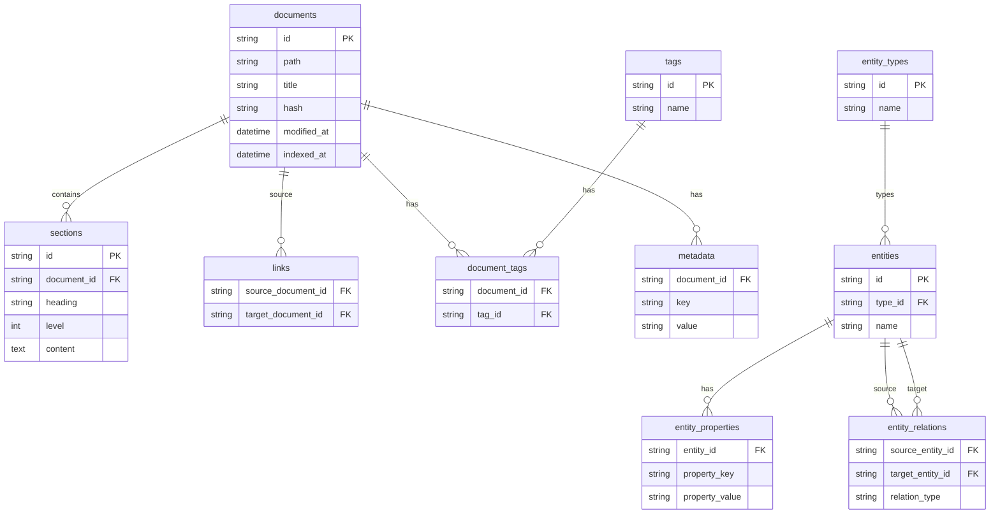
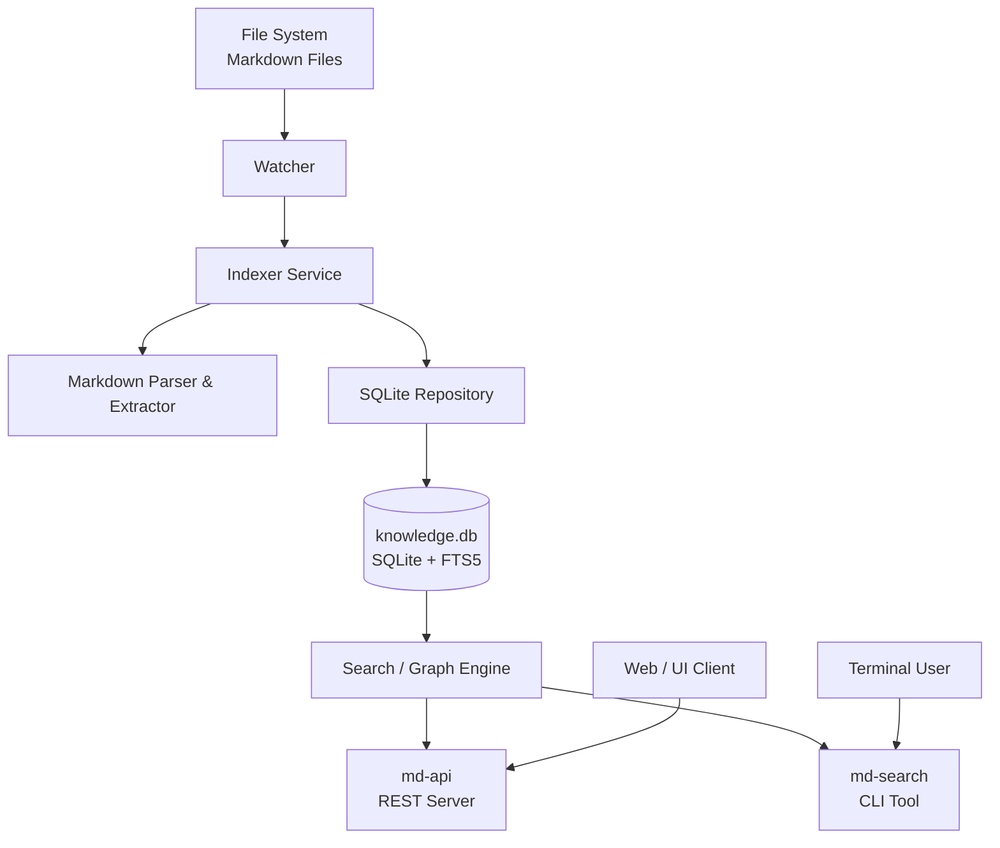

# Markdown Knowledge Indexer & Search Engine

This project provides a local, lightweight knowledge-graph and search infrastructure for Markdown-based note systems (such as Obsidian). The system consists of three core components:

1. **md-indexer**: Monitors Markdown files and incrementally builds a SQLite-based index and knowledge graph. Markdown files remain the single source of truth.
2. **md-search**: A CLI knowledge explorer that operates on the SQLite database (without filesystem access) to perform full-text search, backlink, and graph traversal queries.
3. **md-api**: A REST API that exposes the search and graph features over HTTP.

## Architectural Principles

The system is based on the principles of **Clean Architecture**:
- **Source of Truth**: Markdown files in the filesystem are the only truth. The SQLite database is a pure materialized index and can be deleted and rebuilt at any time.
- **Separation of Concerns**: Strict separation between file parsing (`md-indexer`) and query operations (`md-search` & `md-api`). The search layer has no filesystem access and reads exclusively from the database.
- **Graph Engine via Recursive CTEs**: Graph traversals (dependency trees, impact analysis, shortest paths) are executed in SQLite using recursive Common Table Expressions (`WITH RECURSIVE`), avoiding N+1 query loops while remaining CGO-free.

## Data Model & ER Diagram (SQLite & FTS5)



## Component Diagram



## Setup & Build

The project uses a Makefile for the build process.

```bash
# Build all components (in ./bin)
make build    # md-indexer
make search   # md-search
make api      # md-api

# Run all tests
make test
```

### Docker (Multi-Stage Build)

Alternatively, the system can be deployed entirely via Docker:

```bash
docker build -t md-knowledge-system .
docker run -p 8080:8080 -p 8081:8081 -v /pfad/zum/vault:/app/vault md-knowledge-system
```

## Usage & Examples

### 1. md-indexer (File Watcher & Indexer)

Indexes a folder recursively and monitors it for future changes.

```bash
./bin/md-indexer -dir /path/to/obsidian/vault -db index.db -port 8080
```

### 2. md-search (CLI Explorer)

Allows searching the graph from the terminal. The `-db` flag can be set (default is `index.db`).

```bash
# Full-text search via FTS5 (title, content, tags)
./bin/md-search search "encryption strategy"

# Format output as JSON (available on all subcommands)
./bin/md-search search "encryption strategy" --json

# Show details for a specific document
./bin/md-search document "ADR-003"

# Impact analysis for an entity (incoming dependencies via recursive CTE)
./bin/md-search impact "Package Model"

# Dependency tree for an entity (outgoing dependencies via recursive CTE)
./bin/md-search graph "Transformation Engine"
```

**Planned CLI subcommands (Roadmap):**
```bash
./bin/md-search entity "Transformation Engine"
./bin/md-search backlinks "Encryption Service"
./bin/md-search relations "Transformation Engine"
```

### 3. md-api (REST API)

Starts an HTTP server that accepts search and graph requests (default port 8081).

```bash
make api-run
# or manually:
./bin/md-api -db index.db -port 8081
```

**Endpoints:**

- `GET /health`: System status
- `GET /api/search?q=...`: FTS5 full-text search
- `GET /api/documents/{name}`: Load a specific document
- `GET /api/entities/{name}`: Load an extracted entity (type + properties)
- `GET /api/backlinks/{name}`: Find documents that link to `{name}`
- `GET /api/impact/{name}`: Recursive impact analysis for an entity
- `GET /api/graph/{name}`: Recursive dependency tree for an entity

*(The exact specification is documented in the included `openapi.yaml` file).*

## Example Use Case & Walkthrough

The repository includes a concrete, physically existing sample vault in [`examples/vault/`](examples/vault/) featuring Frontmatter entities, relationships, inline Wikilinks, hashtags, and code blocks:

* [`examples/vault/AuthService.md`](examples/vault/AuthService.md): Service entity declaring relations (`uses: [UserDatabase, TokenSigner]`) and inline Wikilinks.
* [`examples/vault/UserDatabase.md`](examples/vault/UserDatabase.md): Relational database entity referenced by `AuthService`.
* [`examples/vault/TokenSigner.md`](examples/vault/TokenSigner.md): Cryptographic security module implementing `Ed25519` tokens.

### 1. Build All Binaries
```bash
make build search api
```

### 2. Index the Sample Vault
```bash
./bin/md-indexer -dir ./examples/vault -db knowledge.db
```

### 3. Query via CLI Explorer (`md-search`)

**Full-Text Search (FTS5 BM25):**
```bash
./bin/md-search search "Ed25519" -db knowledge.db
```
*Output: Matches `TokenSigner` based on BM25 full-text ranking.*

**Impact Analysis (Reverse Dependency Traversal via Recursive CTE):**
```bash
./bin/md-search impact "UserDatabase" -db knowledge.db
```
*Output: Demonstrates that changing `UserDatabase` directly impacts `AuthService`.*

**Dependency Tree (Forward Traversal via Recursive CTE):**
```bash
./bin/md-search graph "AuthService" -db knowledge.db
```
*Output: Discovers that `AuthService` depends on `UserDatabase` and `TokenSigner`.*

### 4. Query via REST API (`md-api`)

Start the API server:
```bash
./bin/md-api -db knowledge.db -port 8081
```

Query the HTTP endpoints:
```bash
# Retrieve extracted entity details & properties
curl http://localhost:8081/api/entities/AuthService

# Retrieve impact analysis
curl http://localhost:8081/api/impact/UserDatabase

# Retrieve backlinks (notes linking to TokenSigner)
curl http://localhost:8081/api/backlinks/TokenSigner
```

### 5. Automated Verification
This end-to-end physical use-case is continuously verified by an automated integration test:
```bash
go test -v ./examples
```
