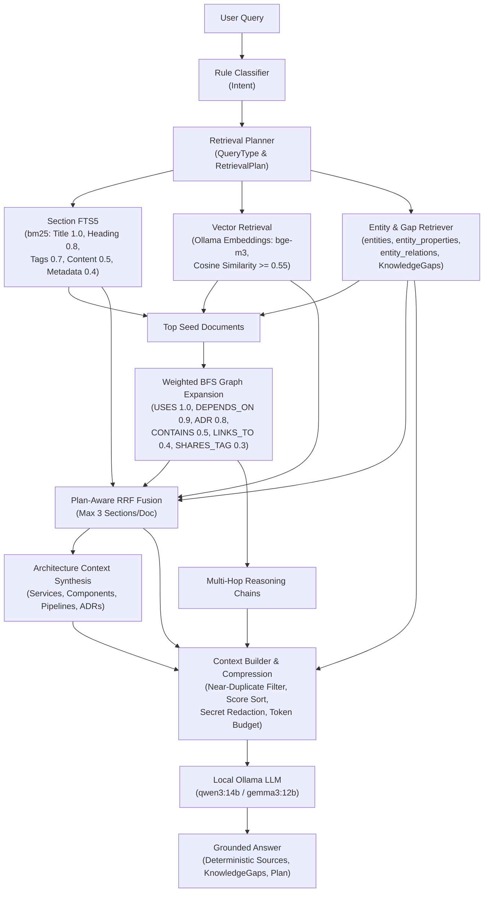

<!--
SPDX-FileCopyrightText: 2026 Zheng-Bote
SPDX-License-Identifier: Apache-2.0
-->

# Advanced Hybrid GraphRAG Retriever (`md-ai`)

Dieses Dokument beschreibt das Architekturdesign, die Pipeline-Stufen, die Konfiguration sowie konkrete Beispielabläufe für jede Query-Klasse des lokalen Hybrid-GraphRAG-Retrievers (`internal/ai/hybrid` und `internal/embedding`).

---

## 1. Architekturüberblick

Der Hybrid-Retriever arbeitet vollständig lokal auf der SQLite-Datenbank (`knowledge.db`, im Read-Only-Modus) und kombiniert vier Retrieval-Quellen über gewichtete Reciprocal Rank Fusion (RRF):



---

## 2. Beispielabläufe je Query-Klasse (Deliverable 14)

### 2.1 Fakten-Frage (`QueryFact`)

- **Beispiel-Query:** `Was ist ADR-003?`
- **Classifier-Intent:** `adr`
- **Retrieval-Plan:**
  ```json
  {
    "query_type": "fact",
    "use_fts": true,
    "use_entities": false,
    "use_graph": false,
    "use_vectors": true,
    "graph_depth": 0,
    "max_results": 8
  }
  ```
- **Ablauf:**
  1. `Terms("Was ist ADR-003?")` filtert das Stoppwort `was`/`ist` und erzeugt die Suchterme `["adr", "003"]`.
  2. `SQLiteFTS` durchsucht `fts_sections` mit BM25-Gewichtung (Titel `1.0`, Heading `0.8`, Tags `0.7`, Content `0.5`, Metadata `0.4`).
  3. `SQLiteVectors` berechnet das Query-Embedding über Ollama (`bge-m3`) und liefert semantisch ähnliche Sektionen mit Cosine Similarity $\ge 0.55$.
  4. `Fuse` führt FTS- und Vektor-Kandidaten zusammen; Treffer mit `ADR` als Wort im Pfad oder Titel erhalten die Strategie `adr` (Priorität 3 im Context Builder).
  5. Kein Graph-Walk nötig – minimale Latenz und fokussierter Kontext.

---

### 2.2 Entitäts-Frage (`QueryEntity`)

- **Beispiel-Query:** `Was ist der Encryption Service?`
- **Classifier-Intent:** `entity`
- **Retrieval-Plan:**
  ```json
  {
    "query_type": "entity",
    "use_fts": true,
    "use_entities": true,
    "use_graph": false,
    "use_vectors": true,
    "graph_depth": 0,
    "max_results": 10
  }
  ```
- **Ablauf:**
  1. `SQLiteEntities.Find` erkennt die benannte Entität `Encryption Service` in `entities`, lädt `type_id`, `description` und `api` aus `entity_properties`, direkte Relationen aus `entity_relations` sowie die Sektionen des definierenden Dokuments.
  2. **Retrieval-Time Knowledge Gap Detection:** Prüft automatisch, ob für `Encryption Service` (Typ `Component`/`Service`) eine Beschreibung, eine verlinkte/referenzierte ADR und eine API-Spezifikation/Sektion existieren. Fehlt z. B. eine ADR, wird `KnowledgeGap{Entity: "Encryption Service", Reason: "no ADR linked or documented"}` erzeugt.
  3. `Fuse` kombiniert Entitäts-Sektionen, FTS5-Treffer und Vektor-Treffer.
  4. Der Context Builder setzt die Entitätsdefinition und ihre Sektionen auf `Priority: 1`.

---

### 2.3 Impact-Frage (`QueryImpact`)

- **Beispiel-Query:** `Welche Komponenten verwenden Encryption Service?`
- **Classifier-Intent:** `impact`
- **Retrieval-Plan:**
  ```json
  {
    "query_type": "impact",
    "use_fts": true,
    "use_entities": true,
    "use_graph": true,
    "use_vectors": false,
    "graph_depth": 3,
    "max_results": 15
  }
  ```
- **Ablauf:**
  1. `SQLiteEntities` und `SQLiteFTS` bestimmen die Seed-Dokumente (z. B. `Encryption Service`).
  2. `SQLiteGraph.Expand` traversiert bis zu `GraphDepth = 3` Hops über `entity_relations` (in beide Richtungen), `links` (Wikilinks) und gemeinsame spezifische Tags (`SHARES_TAG`, 2–10 Dokumente).
  3. Jede Kante wird gewichtet (`USES = 1.0`, `DEPENDS_ON = 0.9`, `ADR = 0.8`, `CONTAINS = 0.5`, `LINKS_TO = 0.4`, `SHARES_TAG = 0.3`, `REFERENCES = 0.2`).
  4. Über `Weights.ForPlan` wird das Graph-Gewicht in der RRF-Fusion auf `0.40` angehoben, damit abhängige Nachbardokumente nicht von reinen Texttreffern verdrängt werden.
  5. `selectChains` extrahiert die besten Multi-Hop-Pfade als `ReasoningChain`, z. B.:
     ```text
     Reasoning chain:
     - [Transformation Engine] --(USES)--> [Package]
     - [Package] --(USES)--> [Encryption Service]
     - [REST Delivery] --(DEPENDS_ON)--> [Encryption Service]
     ```

---

### 2.4 Architektur-Frage (`QueryArchitecture`)

- **Beispiel-Query:** `Wie funktioniert die Ingestion Pipeline?`
- **Classifier-Intent:** `search` → vom `Planner` via Architektur-Pattern als `QueryArchitecture` erkannt.
- **Retrieval-Plan:**
  ```json
  {
    "query_type": "architecture",
    "use_fts": true,
    "use_entities": true,
    "use_graph": true,
    "use_vectors": true,
    "graph_depth": 4,
    "max_results": 15
  }
  ```
- **Ablauf:**
  1. Alle vier Quellen (FTS, Vektoren, Entitäten, gewichteter Graph bis Tiefe 4) laufen parallel bzw. kaskadiert.
  2. `buildArchitectureContext` aggregiert alle gefundenen Dokumente, Entitäten, Relationen und Reasoning-Chains zu einem strukturierten `ArchitectureContext`:
     ```text
     Architecture Context:
     Services: Encryption Service
     Components: REST Delivery, Transformation Engine
     Pipelines: Ingestion Pipeline
     ADRs: ADR-003 Envelope Encryption
     Dependencies:
     - [Ingestion Pipeline] --(LINKS_TO)--> [REST Delivery]
     - [REST Delivery] --(LINKS_TO)--> [Encryption Service]
     - [Encryption Service] --(USES)--> [KMS]
     ```
  3. Dieser Block wird mit `Priority: 2` (`Source: architecture-model`) direkt nach den Entitäten in den Prompt injiziert, gefolgt von den Reasoning-Chains und den deduplizierten Textsektionen.

---

### 2.5 Explorative Suche (`QueryExploration`)

- **Beispiel-Query:** `Luftfeuchtigkeit Sensor Raspberry Pi`
- **Classifier-Intent:** `search`
- **Retrieval-Plan:**
  ```json
  {
    "query_type": "exploration",
    "use_fts": true,
    "use_entities": true,
    "use_graph": true,
    "use_vectors": true,
    "graph_depth": 1,
    "max_results": 12
  }
  ```
- **Ablauf:**
  1. FTS5 findet exakte Begriffe (`Raspberry`, `Sensor`), während die Vektorsuche (`bge-m3`) auch Komposita und Synonyme wie `Luftfeuchte-Logger` oder `Feuchtigkeitssensor` mit hoher Cosine Similarity liefert.
  2. Graph-Expansion (`GraphDepth = 1`) ergänzt unmittelbar verlinkte Notizen.
  3. Der Context Builder entfernt Near-Duplicates (Jaccard $\ge 0.80$), maskiert eventuelle Secrets (`[REDACTED]`), schätzt das Token-Budget konservativ (`~3 Bytes/Token`) und übergibt alle genutzten Kontextdokumente deterministisch in `Answer.Sources`.
